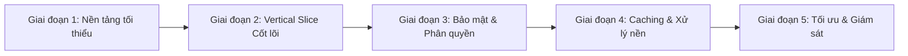

# Kế Hoạch Phát Triển Sản Phẩm Toàn Diện (Vertical Slice Roadmap)

> **Mục tiêu:** Xây dựng hệ thống hoàn chỉnh đáp ứng 100% tiêu chí chuẩn công nghiệp (Frontend State UX, Security, SEO, Backend API, AuthN/AuthZ, DB ACID, Caching, Queue, Structured Logging).
> **Phương pháp tiếp cận:** **Vertical Slice Architecture** (Lát cắt dọc) — phát triển hoàn thiện luồng nghiệp vụ cốt lõi từ DB đến UI trước, sau đó mở rộng và hoàn thiện các tầng hạ tầng/bảo mật.

---

## Tổng quan các giai đoạn thực hiện



---

## Giai đoạn 1: Thiết lập Nền tảng & Chuẩn hóa Kiến trúc (Foundational Baseline)
*Mục tiêu: Dựng bộ khung chuẩn, định nghĩa convention để toàn bộ code sau này đi đúng ray, không phải refactor cấu trúc.*

### 1.1. Cấu trúc thư mục Module hóa (Frontend & Backend)
```text
src/
├── app/                  # Next.js App Router (Pages, Layouts, Route Handlers)
│   ├── api/v1/           # API routes có tiền tố versioning
│   └── (routes)/         # UI route groups
├── components/           # UI Components tái sử dụng (Button, Modal, Skeleton...)
├── hooks/                # Custom React hooks (logic UI, state tái sử dụng)
├── lib/                  # Shared utilities, DB client (Prisma), Redis, Logger
├── modules/              # Domain modules (clearance, reservation, product...)
│   ├── components/       # Component đặc thù của domain
│   ├── hooks/            # Hooks gọi API & mutation (SWR / React Query)
│   ├── services/         # Logic gọi API hoặc server service
│   └── schemas/          # Zod schema dùng chung cả Client & Server
├── types/                # TypeScript interface / types dùng chung
└── utils/                # Helper functions thuần túy (format, time, math)
```

### 1.2. Chuẩn hóa API Response & Global Exception
- Định dạng Response đồng nhất cho mọi endpoint:
  ```typescript
  interface ApiResponse<T> {
    success: boolean;
    data?: T;
    message?: string;
    errorCode?: string;
    timestamp: string;
    requestId: string;
  }
  ```
- Tạo helper `apiResponse.success(data)` và middleware/wrapper bắt lỗi tập trung (Global Exception Handler) để không làm rơi stack trace nhạy cảm ra ngoài client.

### 1.3. Quản lý State: Phân tách rõ ràng
- **Client State:** Dùng Zustand hoặc React Context cho UI state thuần túy (modal, drawer, theme, step form).
- **Server Cache / State:** Cấu hình chuẩn `SWR` (hoặc TanStack Query) với options mặc định: `revalidateOnFocus: false`, `dedupingInterval`, retry logic khi network fail.

---

## Giai đoạn 2: Hoàn thiện Lát Cắt Dọc Cốt Lõi (Core Vertical Slice)
*Mục tiêu: Đưa 1–2 tính năng sống còn của sản phẩm chạy mượt mà từ Database đến Frontend với đầy đủ trải nghiệm State UX và Validation.*

### 2.1. Thiết kế Schema DB & Migration
- Chuẩn hóa schema (ví dụ: `Product`, `ClearanceItem`, `Reservation`).
- Đánh **Index** ở các cột tìm kiếm/lọc thường xuyên: `expiresAt`, `status`, `currentQuantity`.
- Áp dụng migration có phiên bản (`prisma migrate dev`).

### 2.2. Trải nghiệm Trạng thái (State UX) trọn vẹn
Mỗi màn hình/component kết nối API bắt buộc xử lý đủ **4 trạng thái**:
1. **Loading State:** Sử dụng **Skeleton UI** (khung mờ dạng placeholder) khớp với layout thật thay vì vòng xoay spinner trơn.
2. **Success State:** Dữ liệu hiển thị mượt mà, chuyển cảnh êm.
3. **Empty State:** Minh họa thân thiện khi danh sách rỗng kèm nút Call-To-Action (ví dụ: *"Chưa có món xả kho nào, hãy quay lại sau!"*).
4. **Error State:** Thông báo lỗi ngôn ngữ tự nhiên (không hiển thị lỗi hệ thống kỹ thuật), luôn kèm **nút Thử lại (Retry)** gọi lại mutation/refetch.

### 2.3. Tương tác & Validation
- **Form Validation 2 đầu:** Định nghĩa 1 schema bằng **Zod** duy nhất, dùng ở cả Client (React Hook Form) và Server (Route Handler).
- **Feedback tương tác:**
  - `debounce` 300–400ms trên thanh tìm kiếm/lọc.
  - Disable nút Submit, hiển thị loading spinner nhỏ bên trong nút khi đang gửi request để triệt tiêu lỗi **double-click / double-order**.

### 2.4. Tính toàn vẹn dữ liệu (Database ACID Transaction)
- Các thao tác trừ kho, giữ chỗ (`Reservation` tạo mới + trừ `currentQuantity` của `ClearanceItem`) phải nằm trọn trong `prisma.$transaction()` để loại trừ triệt để tình trạng overselling (bán quá số lượng tồn kho).

---

## Giai đoạn 3: Bảo mật, Xác thực & Phân quyền (Security & Auth)
*Mục tiêu: Khóa chặt mọi lỗ hổng bảo mật phía Client lẫn Server trước khi mở rộng tính năng.*

### 3.1. Xác thực (AuthN) & Phân quyền (AuthZ)
- **Token Mechanism:**
  - `Access Token`: Thời hạn ngắn (15–30 phút), dùng để xác thực request.
  - `Refresh Token`: Thời hạn dài (7–30 ngày), lưu trữ trong cookie `HttpOnly`, `Secure`, `SameSite=Strict/Lax` nhằm chống đánh cắp token qua tấn công XSS.
- **Middleware Phân quyền (RBAC):**
  - Chặn quyền ở Middleware Server / API Route Handler (kiểm tra Role `MERCHANT` vs `CUSTOMER`), frontend chỉ ẩn nút để phục vụ UX, không phụ thuộc vào frontend để bảo mật.

### 3.2. Bảo mật Server & Client
- **Sanitize & Escape:** Loại bỏ mã độc đầu vào, cấm dùng `dangerouslySetInnerHTML` tùy tiện ở Frontend.
- **Rate Limiting:** Cấu hình giới hạn request theo IP (ví dụ: tối đa 10 req/phút cho route đặt chỗ, 5 req/phút cho login) nhằm chặn spam bot và brute-force.
- **CORS Whitelist:** Cấu hình domain cụ thể, không dùng wildcard `*` cho các route yêu cầu xác thực.
- **Bảo mật Biến môi trường:** Không đặt prefix `NEXT_PUBLIC_` cho bất kỳ secret key, API key thanh toán, DB credentials nào.

### 3.3. API Documentation & Versioning
- Đặt URL dạng `/api/v1/...`.
- Cung cấp tài liệu API tự động cập nhật qua Swagger UI hoặc OpenAPI spec.

---

## Giai đoạn 4: Xử lý Nền, Caching & Tối ưu Hiệu năng (Scale & Performance)
*Mục tiêu: Đảm bảo hệ thống chịu tải cao, phản hồi nhanh và mượt mà trên mọi thiết bị.*

### 4.1. Caching Layer (Redis)
- Cache kết quả truy vấn danh sách sản phẩm xả kho đang hoạt động (TTL: 10–30 giây hoặc invalidate khi có mutation).
- Giảm thiểu số lượng truy vấn trực tiếp vào Database chính khi lưu lượng tăng đột biến.

### 4.2. Hàng đợi Xử lý Nền (Background Jobs & Workers)
- Đẩy các tác vụ nặng ra khỏi luồng request chính (dùng BullMQ / Redis hoặc Serverless Cron):
  - Tác vụ quét đơn hết hạn (Auto-release expired reservation) để tự động hoàn kho sau 15–20 phút.
  - Tính toán lộ trình giảm giá AI (Price Decay recalculation).
  - Gửi email, SMS xác nhận, xuất file báo cáo.

### 4.3. Tối ưu Hiển thị & Tải trang (Client Optimization)
- **Code-splitting / Dynamic Import:** Dùng `next/dynamic` cho các modal nặng, biểu đồ phức tạp, camera scanner để giảm bundle size ban đầu.
- **Tối ưu hình ảnh:** Dùng `next/image` tự động chuyển đổi sang WebP/AVIF, bắt buộc thuộc tính `width`, `height` hoặc `fill` để loại trừ hiện tượng giật màn hình (CLS = 0).
- **Virtual List / Infinite Scroll:** Áp dụng khi danh sách hàng dài hơn 50 phần tử để DOM luôn gọn nhẹ.
- **Responsive Design:** Kiểm tra hiển thị tương thích đa màn hình từ Mobile (375px), Tablet đến Desktop.

### 4.4. SEO & Metadata
- Cấu hình Open Graph đầy đủ: `title`, `description`, `og:image`, `canonical URL`.
- Bổ sung `favicon.ico`, `manifest.json` phục vụ PWA/Mobile experience.

---

## Giai đoạn 5: Giám sát, Logging & Sẵn sàng Vận hành (Observability & Production Readiness)
*Mục tiêu: Đảm bảo khi có sự cố, đội ngũ phát hiện tức thì và truy vết được nguyên nhân gốc rễ trong vài phút.*

### 5.1. Structured Logging
- Ghi log định dạng JSON có cấu trúc:
  ```json
  {
    "timestamp": "2026-10-20T09:00:00.000Z",
    "level": "error",
    "requestId": "c1f7a0b3-9e42-4f11",
    "route": "/api/v1/reservations",
    "userId": 42,
    "message": "Out of stock during transaction",
    "context": { "clearanceItemId": 105, "requestedQty": 2 }
  }
  ```
- Tích hợp `requestId` xuyên suốt từ Middleware tới Handler để liên kết log của cùng một request.

### 5.2. Health Check & Error Tracking
- Tạo route `/api/health` kiểm tra trạng thái kết nối Database, Cache (Redis).
- Bắt lỗi runtime tự động gửi cảnh báo (Sentry / Datadog).

---

## Bảng Đối Chiếu Tiêu Chí Nghiệm Thu (Criteria Mapping Matrix)

| Nhóm Tiêu Chí | Hạng mục cụ thể | Giai đoạn triển khai | Trạng thái |
| :--- | :--- | :---: | :---: |
| **Frontend Architecture** | Cấu trúc module hóa, phân tách Client State & Server Cache | Giai đoạn 1 | ⏳ Ready |
| **Frontend UX** | 4 States (Loading Skeleton, Success, Error, Empty), Debounce, Submit lock | Giai đoạn 2 | ⏳ Ready |
| **Frontend Performance** | Code-splitting, WebP/AVIF, CLS prevention, Virtual list, Responsive | Giai đoạn 4 | ⏳ Ready |
| **Frontend Security** | Zod validation, XSS escaping, Không lộ secret key bundle | Giai đoạn 3 | ⏳ Ready |
| **SEO & Metadata** | Dynamic Meta tags, Open Graph, Favicon, Manifest | Giai đoạn 4 | ⏳ Ready |
| **Backend API Design** | RESTful chuẩn HTTP Code, Unified payload, Swagger, Versioning /v1 | Giai đoạn 1, 3 | ⏳ Ready |
| **AuthN & AuthZ** | Access/Refresh Token (HttpOnly Cookie), RBAC Middleware chặn Server | Giai đoạn 3 | ⏳ Ready |
| **Database Architecture** | Schema chuẩn, Indexing, Migrations, ACID Transactions | Giai đoạn 1, 2 | ⏳ Ready |
| **Caching & Jobs** | Redis Cache, Message Queue/Workers (Release stock, decay price) | Giai đoạn 4 | ⏳ Ready |
| **Backend Security** | Input Sanitization, Rate Limiting, CORS Whitelist | Giai đoạn 3 | ⏳ Ready |
| **Logging & Monitoring** | Global Exception Filter, Structured JSON Log có RequestId | Giai đoạn 1, 5 | ⏳ Ready |
